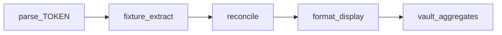

# Runbook: Money conversion debug

Use this when overview KPIs, ledger USD, Ready to Assign, or adapter recon look wrong.

**Privacy:** Exact **integer cents / USD** may appear in CLI stdout and Cursor chat. Do **not** paste raw statement bodies, SSN, driver’s license, street addresses, raw account numbers, or personal names. Prefer scrubbed CLI output, redacted fixtures under `tests/fixtures/redacted/`, and opaque `*.probe.json` (booleans/counts only).

**Entry point:**

```bash
uv run python scripts/debug_money.py <subcommand> ...
```

## Stages



## Playbook (LLM / human)

1. **Reproduce the symptom**  
   Dashboard overview Liquid / Brokerage / Ready to Assign, or a ledger closing balance.

2. **Is it aggregation?**  
   ```bash
   uv run python scripts/debug_money.py vault
   ```  
   Compare `liquid_closing_cents`, `brokerage_closing_cents`, `ready_to_assign_cents`.  
   Ready to Assign must equal liquid (minus envelopes), **never** include brokerage or cards.  
   If vault numbers look right but the UI does not, the bug is display/template wiring — go to step 5.

3. **Is it extract / recon on one statement?**  
   Prefer committed fixtures or redacted PDFs (never raw customer PDFs in chat):
   ```bash
   uv run python scripts/debug_money.py fixture tests/fixtures/chase_checking_happy.json
   uv run python scripts/debug_money.py fixture tests/fixtures/redacted/schwab_checking_sample.pdf
   ```  
   Check `opening_cents` / `closing_cents` / `net_cents` vs `txn_sum_cents`.  
   Txn lines show **date + category + cents only** (no descriptions).

4. **Is it a single token parse?**  
   Take the suspicious token from an error detail or fixture JSON field — not from a PDF body dump:
   ```bash
   uv run python scripts/debug_money.py parse '$1,295.00'
   uv run python scripts/debug_money.py parse '($12.34)'
   ```

5. **Is it display-only?**  
   If DB / fixture cents are correct but the screen looks wrong:
   ```bash
   uv run python scripts/debug_money.py format 129500
   ```  
   Must round-trip to the same cents via `format_usd_cents`.

6. **Schwab brokerage footgun**  
   `fixture` on brokerage paths prints a `[WARN]` that `schwab_brokerage` still uses legacy `SchwabAdapter._parse_cents` (magnitudes; diverges from `parse_currency_to_cents`). Treat parse mismatches there as high-risk.

7. **One-shot pipeline**  
   ```bash
   uv run python scripts/debug_money.py pipeline tests/fixtures/chase_checking_happy.json --token '$1,295.00'
   ```

8. **Explicit equation check**  
   ```bash
   uv run python scripts/debug_money.py diff-stage --expected 29500 --actual 29500 --label net_vs_txn_sum
   ```

## QA

```bash
uv run python scripts/qa_money_debug.py
```

Uses `sapphire_test` only (never truncates dogfood `/sapphire`).

## Out of scope

- Dumping `page_text` / PDF bodies into Cursor  
- Putting `amount_cents` into structured logger extras (production telemetry still strips them)  
- Cloud/frontier tools that return raw statement text
