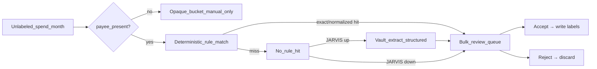

# Pitch: Bulk suggest labels (correct a handful)

**Status:** Bet (Brian LGTM 2026-11-23 · ACRA-24 / ACRA-26)  
**Builder:** Cloud agent (Cloud-Build Mode)  
**Bettor:** Human PM (Brian)  
**Appetite:** Small Batch — ship **B0 → B1 → B2** first; Vault lane loud-downtime when JARVIS is down

---

## Problem

Overview History’s spend-by-category pie ships, but dogfood spend stays ~100% Uncategorized. Manual per-row ledger labels work but do not scale past a handful of clicks. Rule assist and Vault suggest exist only as reserved `source` values. Schwab checking PDFs are opaque `Electronic Withdrawal` with `payee=NULL` — rules/LLM must not invent merchants. Chase-like merchant payees can be bulk-corrected once suggestions group by payee and Accept writes many labels in one decision.

## Appetite

**Small Batch.** Good enough when Ledger shows a Suggest panel that: runs deterministic payee→slug rules, stages groups (no writes until Accept), Accept/Reject by payee group, reports opaque EW count loudly, and either stages Vault residuals when JARVIS is up or shows loud downtime with rules still usable. Circuit-break B3 (save-as-rule UX) and B5 (export ingest) if time runs out.

## Solution (breadboard)

**Ordered bets:** B0 pitch/wireframe → B1 `spend_label_rules` + matcher → B2 staging + bulk Accept/Reject UI (+ Vault lane with downtime). Hold auto-apply. Opaque rows never enter the suggestable set.

## Visuals (shaping)

- Wireframe: [`visuals/bulk_suggest_labels_wireframe.html`](visuals/bulk_suggest_labels_wireframe.html)
- Placement: Ledger Suggest panel (Overview pie stays read-only)
- States: review queue · JARVIS down · before Run suggest · opaque-heavy Schwab

## Rabbit holes

- Inventing Schwab merchants from amount rhythm
- Auto-apply LLM labels or cloud models on raw rows
- Waiting on JARVIS restore before shipping rules + bulk Accept
- Wipe/re-seed Metrotower dogfood data
- Perfect “save as rule” admin (B3) before Accept/Reject works

## No-gos

- Silent auto-apply on page load
- Suggesting opaque EW / `payee IS NULL` rows
- Cloud / frontier models on raw rows
- Logging payee, description, or `amount_cents`
- Float money; pie amounts stay integer cents from `transactions`
- Wipe or re-seed personal Vault data as part of this bet

## Done-when

- [ ] B0 pitch + wireframe linked under `docs/specs/`
- [ ] B1 rule table + normalize/exact matcher; ambiguous multi-match fails loud
- [ ] B2 Run suggest → group-by-payee Accept/Reject; Accept writes `source=rule` (and `vault_suggest_accepted` when Vault stages)
- [ ] Opaque honesty strip always reports EW ineligible count
- [ ] JARVIS down → Vault lane skipped with loud UI; rules still work; no soft offline guesses
- [ ] Executable `scripts/qa_bulk_suggest_labels.py` with `[PASS]`/`[FAIL]` happy + negative
- [ ] Manual UI QA on Ledger Suggest panel (no dogfood wipe)

## Out of scope (this bet)

- B3 save-as-rule from Accept
- B5 Schwab CSV/OFX export ingest (parallel track for PDF opacity)
- Extending `TransactionCategory` with groceries/rent
- Envelope↔txn pie series
