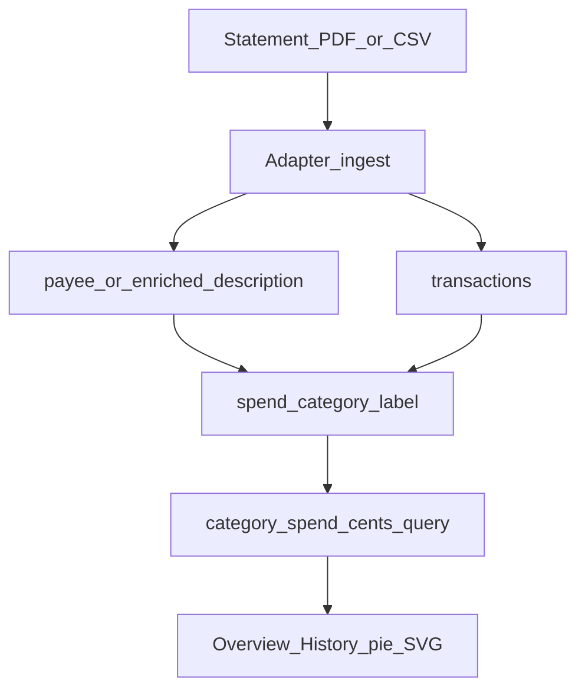

# Pitch: Category spend pie (payee → labels → pie)

**Status:** Bet (wireframe LGTM 2026-11-23)  
**Builder:** Cloud agent (Cloud-Build Mode)  
**Bettor:** Human PM (Brian)  
**Appetite:** Small Batch (2 weeks) — ordered micro-PRs toward the pie

---

## Problem

Overview History already charts pipeline `transaction_category` income vs spend. That is ledger semantics (`withdrawal` / `deposit`), not merchant/budget buckets (groceries, rent). Schwab checking dogfood often lands opaque descriptions (`Electronic Withdrawal` × many rows), so there is no payee to bucket. Envelopes are Ready-to-Assign allocation — not a spend-by-category series. The PM cannot answer “where did October spend go?” without inventing categories on top of the wrong enum.

## Appetite

**Small Batch.** Good enough when Overview → History has a **third block**: spend-by-category pie for a selected calendar month, integer cents, explicit **Uncategorized** bucket, calendar month/year jump as primary control (prev/next step secondary). Ship as ordered stacked PRs; circuit-break optional rule-assist and Vault LLM suggest if time runs out.

## Solution (breadboard)

Three concepts stay distinct:

1. **Pipeline category** — existing `TransactionCategory` (untouched money-truth ledger tag).
2. **Payee / counterparty** — richer text from ingest (nullable `payee` preferred over overwriting raw `description`).
3. **Spend category** — closed merchant/budget taxonomy for the pie (`spend_categories` + `transaction_spend_labels`).

**Build order (hard deps):** `0 pitch/wireframe → 1 payee inventory → 2 payee ingest → 3 taxonomy + manual label → 5 pie SVG`. Rule assist (4) and Vault LLM suggest (6) are optional after 3. Envelope↔txn link is a parallel track only if pie becomes envelope-based (PM said no for v1).

**Aggregation:** for selected calendar month, `SUM(ABS(amount_cents))` where `amount_cents < 0`, group by spend-category slug; unlabeled → **Uncategorized**. Integer cents only; SVG from ints; display via `usd_cents`. Fail loud on unknown slug / missing FK.

## Visuals (shaping)

- Wireframe (UX locked): [`visuals/category_spend_pie_wireframe.html`](visuals/category_spend_pie_wireframe.html)
- Placement: Overview → History **third block** (after balances + pipeline income/spend).
- Period control: **calendar primary** (month + year jump across statement history); ← → steps one month (secondary).
- Empty: no outflow → loud `HISTORY_SPEND_CATEGORY_EMPTY`.
- Unlabeled spend: show pie with **Uncategorized** slice (not block-until-labeled for v1).

## Rabbit holes

- Extending `TransactionCategory` with groceries/rent (breaks domain/sign contracts).
- Overloading envelope balances as the pie series without a link table.
- Chart.js / CDN / float axes / invented SRI.
- Auto-apply LLM labels or cloud models on raw rows.
- Re-seeding / wiping Metrotower personal dogfood data.
- Perfect payee extraction from opaque Schwab PDF rows (inventory first; opaque stays unlabeled).

## No-gos

- New top-level “Charts” nav.
- Envelope pie as v1 series.
- Float money; logging `amount_cents` or payee PII.
- Pie of pipeline `withdrawal` vs `fee` only.
- Depend on JARVIS being up for the product path (manual + optional rules first).
- Wipe or re-seed personal Metrotower Vault data as part of this bet.

## Done-when

- [ ] Ordered PRs land: pitch/docs → payee inventory → payee ingest → taxonomy + manual label → pie SVG + calendar UX
- [ ] Executable QA per PR (`scripts/qa_*.py`) with `[PASS]` / `[FAIL]` happy + negative
- [ ] Manual UI QA: Overview History third block matches wireframe (calendar primary, Uncategorized, integer cents)
- [ ] Wireframe linked under `docs/specs/visuals/`
- [ ] Core invariants: integer cents, fail-loud contracts, no PII/amount logging
- [ ] CI gates: ruff + `pytest --cov=app --cov-fail-under=90`
- [ ] GitHub Project board updated

## Circuit breaker

Ship the pie with manual labels + Uncategorized even if payee density is low and rule/LLM assist are unfinished. Return Vault suggest-only, payee→category rules, and txn→envelope links to [`raw_backlog.md`](raw_backlog.md) or a follow-on pitch.
