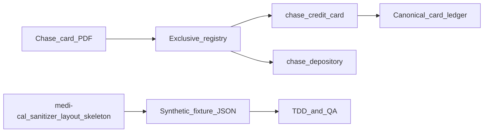

# Pitch: Chase credit card adapter

**Status:** In-bet  
**Builder:** Cloud agent (Cloud-Build Mode)  
**Bettor:** Human PM  
**Appetite:** Small Batch (2 weeks)

---

## Problem

The household dogfoods **Chase credit cards**, not Chase checking. Checking lives at Charles Schwab and San Francisco Federal Credit Union (later bets). Uploading a Chase card PDF today fails with loud `ADAPTER_MATCH_FAILED` because only `chase_depository` and synthetic `standard_credit_card` exist. Dashboard copy still says “Chase or Schwab,” which encodes the wrong stack.

## Appetite

**Small Batch (2 weeks).** Good enough: a registered `chase_credit_card` adapter that matches Chase card page‑1 branding exclusively, parses the synthetic SAPPHIRE card contract (ACCOUNT SUMMARY + signed TRANSACTIONS), reconciles integer cents, and uploads via the dashboard. Schwab checking and SFFCU stay out of scope.

## Solution (breadboard)

1. Offline fixture factory (medi-cal-sanitizer): sanitize → opaque JARVIS report → `layout_skeleton.py` synthetic JSON (agent never reads raw/sanitized statement bodies).
2. `ChaseCreditCardAdapter` registered next to depository; mutual exclusion on card vs checking markers.
3. Honest upload copy listing supported domains (Chase **card**, Schwab **brokerage**, etc.).

## Visuals (shaping)

- Copy-only change on Statements / empty states: [`visuals/chase_credit_card_copy_note.md`](visuals/chase_credit_card_copy_note.md).

## Rabbit holes

- Full production Chase multi-card / multi-page layout variants beyond the synthetic contract.
- Schwab checking or SFFCU adapters.
- Wiring sanitizer into the Vault runtime path (stays offline fixture factory).

## No-gos

- No silent coercion of unmatched banks.
- No reading raw or sanitized personal statements into Cursor.
- No float money; no PII/amount logging.
- No Schwab checking / SFFCU in this appetite.

## Done-when

- [x] Executable QA: `uv run python scripts/qa_chase_credit_card.py`
- [x] Manual UI QA: upload synthetic Chase card PDF from fixture render; expect Vault Ledger. Non-card / unknown bank still `ADAPTER_MATCH_FAILED`.
- [x] Wireframe/copy note linked
- [ ] Core invariants + CI gates on PR
- [ ] GitHub Project board updated on merge

## Circuit breaker

Ship matcher + standard-card-compatible Chase parse for the synthetic contract; return exotic Chase card layouts to raw backlog.
