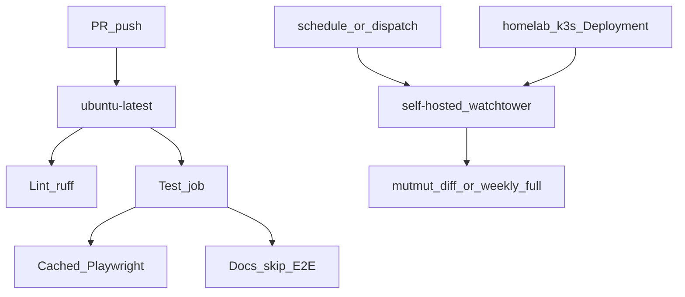

# Pitch: CI reliability (un-crawl + Watchtower mutation)

**Status:** Shaped  
**Builder:** Cloud agent (Cloud-Build Mode)  
**Bettor:** Human PM  
**Appetite:** Small Batch (2 weeks)

**Separate from:** [`pitch_history_charts.md`](pitch_history_charts.md) — different Project item and build cycle. Do not stack into a History charts In-bet.

---

## Problem

PR merges crawl: Playwright installs on every run, docs/markdown-only PRs still pay the full test job, and occasional `playwright install --with-deps` hangs burn wall clock (e.g. sapphire [#62](https://github.com/bstruong/sapphire/pull/62)). Healthy app PR CI is already ~3.5–4 min; the tax is cold browser install and path-blind jobs, not missing mutmut on the PR path.

Mutation is the **Actions-minute** killer (homelab [PR #33](https://github.com/bstruong/homelab-k3s/pull/33) / Option-1 plan: Sapphire ~91% of spend, mutation the driver). Auto triggers on [`mutation-nightly.yml`](.github/workflows/mutation-nightly.yml) are disabled, so AGENTS still promises a gate that does not run on GitHub-hosted. Homelab #33 is docs-only today — no Watchtower runner Deployment yet.

## Appetite

**Small Batch (2 weeks).** Good enough: (1) GitHub-hosted PR CI that caches Playwright and skips E2E/browser install on docs-only paths while keeping the ≥90% cov gate on app changes; (2) mutation **kept and redrawn** onto a self-hosted Watchtower runner (diff + weekly full / dispatch), still **off** the PR merge path; (3) Option-1 runner online from homelab-k3s. If time runs out, ship Track 1 + dispatch-only mutation on self-hosted with a documented DB fallback — do not silently extend.

## Mutation keep / redraw verdict

| Decision | Verdict |
|----------|---------|
| Keep mutation? | **Yes** — valuable for the financial allowlist (especially `app/pipeline/validator.py` **100% kill** / zero survivors + classic `killed/(killed+survived) ≥ 55%`, `no_tests == 0`). |
| Keep as PR required check? | **No** — stays off the merge path (unchanged product call). |
| Full-allowlist every night on `ubuntu-latest`? | **No** — burns free-tier minutes; not worth the quota cost. |
| Redraw | Self-hosted `[self-hosted, watchtower]`: path-filtered **diff** on `main` + **weekly** full-allowlist (or `workflow_dispatch` full); fix mutmut cache key (drop `${{ github.sha }}`); align `AGENTS.md` with reality. |

## Solution (breadboard)

**Option B** = PR-CI hygiene on GitHub-hosted **plus** deploy Option-1 Watchtower runner and run mutation there. Cross-repo: sapphire workflows + AGENTS/docs; homelab-k3s runner manifests ([homelab #33](https://github.com/bstruong/homelab-k3s/pull/33) Option-1).

### Track 1 — PR CI on GitHub-hosted (sapphire)

1. Cache Playwright browsers (key on Playwright/OS version); avoid cold `install --with-deps` every run.
2. Path-aware test job: docs/specs / markdown-only → lint + agent-review (or pytest without E2E) and **skip Playwright install**.
3. App-touching PRs: keep `pytest --cov=app --cov-fail-under=90` including E2E when browsers are cached.
4. Do **not** move required PR checks to self-hosted in this appetite (avoids SPOF if Watchtower is down).

### Track 2 — Mutation redraw (sapphire)

1. Keep invariants above; still **not** a PR required check.
2. Default automation on self-hosted: path-filtered diff on `main` + weekly full-allowlist (or dispatch full).
3. Fix mutmut cache key so cache hits across commits.
4. Align `AGENTS.md` (no “nightly always on github-hosted”).
5. Executable policy QA: e.g. `scripts/qa_ci_reliability.py` asserting no mutmut on `ci.yml`, mutation `runs-on` self-hosted, docs path skip present.

### Track 3 — Watchtower runner (homelab-k3s)

1. Land / fold `docs/ci-runner-migration-plan.md` from [homelab #33](https://github.com/bstruong/homelab-k3s/pull/33).
2. Seal registration token → `manifests/watchtower/github-runner/` Deployment (`myoung34/github-runner`, labels `self-hosted,watchtower,x64,zen5`, hostPath CI cache, CPU/mem limits per plan).
3. Point sapphire mutation: `runs-on: [self-hosted, watchtower]`; spike Postgres **service containers** early (circuit-break to host Postgres sidecar if DinD fails).
4. Smoke `workflow_dispatch` on Watchtower; re-enable schedule **only** on self-hosted.
5. Verify GitHub spending limit $0 (plan Phase 1).

## Visuals (shaping)

Manual UI QA: not applicable (no user-visible UI). Ops breadboard is the mermaid above — no dashboard wireframe.

## Rabbit holes

- ARC / scale-to-zero runner fleets.
- Perfect DinD + every GitHub Actions service-container edge case on the runner image.
- Re-tuning the entire mutation allowlist vs fixing runner + cache + schedule shape.
- Bundling product UI (history charts, adapters) into this ops bet.

## No-gos

- ARC / scale-to-zero fleet in this appetite.
- Re-adding mutmut as a **PR** required check.
- Moving **all** PR CI to self-hosted (merge SPOF).
- Killing mutation entirely without replacing validator kill assurance.
- Bundling [`pitch_history_charts.md`](pitch_history_charts.md) implementation into this bet.
- Inventing frontend SRI hashes or asset UUIDs (N/A for this surface, still held).

## Done-when

- [ ] Pitch + Project item Lane=Shaped (separate from History charts)
- [ ] Docs-only PR completes without Playwright install / full E2E wall
- [ ] App PR CI uses cached Playwright; healthy run clearly under prior ~4 min cold-install tax
- [ ] Watchtower runner online; mutation `workflow_dispatch` green on `[self-hosted, watchtower]`
- [ ] Scheduled/path mutation re-enabled on self-hosted only; `AGENTS.md` + nightly workflow match
- [ ] Executable QA: `uv run python scripts/qa_ci_reliability.py` prints `[PASS]` / `[FAIL]` for happy and negative policy cases
- [ ] Manual UI QA: not applicable (no user-visible UI)
- [ ] Core invariants held where touched (financial modules still killable; no PII/amount logging)
- [ ] CI gates: `uv run ruff check .`, `uv run ruff format --check .`, `uv run pytest --cov=app --cov-fail-under=90 -v` (on app-touching PRs; docs path may slim)
- [ ] GitHub Project board updated (Lane=Shipped / Circuit-broken / Raw); `ARCH_PLAN.md` pointer stays accurate

## Circuit breaker

At appetite end: ship Track 1 + whatever of Tracks 2–3 is green, **or** drop. If runner Postgres services fail, ship Track 1 + dispatch-only mutation on self-hosted with documented host DB. Unfinished ARC and “all CI on Watchtower” return to [`raw_backlog.md`](raw_backlog.md). Do not silently extend; do not absorb History charts scope.
