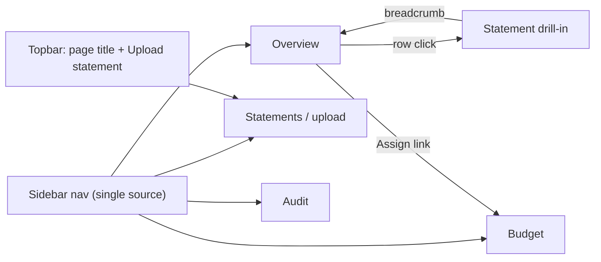

# Pitch: Dashboard refresh (simple, modern UI)

**Status:** In-bet (implementation complete; merge ships)  
**Builder:** Cloud agent (Cloud-Build Mode)  
**Bettor:** Human PM  
**Appetite:** Small Batch (2 weeks)

---

## Problem

The dashboard works, but it is hard to use and looks like a dev tool:

- **Navigation is duplicated.** The left pane has `Budget` / `Upload & Audit` tabs and the right pane header has `Overview` / `Budget` buttons. They hit the same endpoints and a hand-written `switchActionTab()` keeps them in sync. Users can't tell which one is "the" nav.
- **The most important number is buried.** Total closing balance and Ready to Assign show up as small text inside a generic `analysis-result` box with a `Status: from Vault` badge.
- **Forms and results are split 50/50.** Upload, ledger refresh, frontier audit, and envelope forms all live in one narrow column; results show up in a different column.
- **Styling is inline and ad hoc.** Many `style="…"` attributes, GitHub-dark colors, emoji icons, and no light theme.
- **Empty and error states are an afterthought.** A yellow `empty` badge and a red `failed` badge with raw text.

## Appetite

**Small Batch (2 weeks).** Good enough: the four existing surfaces (Overview, Budget, Statements/upload, Audit) plus statement drill-in and empty/error partials use the new shell and design tokens. Behavior, services, DB schema, and money contracts do not change.

## Solution (breadboard)

1. **App shell:** a left sidebar (brand, nav, a "Local Vault online" trust card) and a main column with a sticky top bar (page title and one primary action: *Upload statement*). It replaces the two-pane layout and both tab rows. Each nav item is an `hx-get` into one main target (`#pane-vault-body` stays as the swap target).
2. **Overview:** a KPI row on top (a hero **Total closing balance** card with net-change chip, **Ready to Assign** with an "Assign →" link, and **Last statement**). Below it, an **Accounts** list: institution avatar, masked account, period, opening, closing + net chip. The whole row is clickable and opens the drill-in.
3. **Budget:** a **Ready to Assign** banner with the assign form inline (envelope, `$` amount, Assign). Below it, an **Envelopes** list with an inline "new envelope" input at the bottom.
4. **Statements:** a drag-and-drop styled `<label id="upload-dropzone">` around the native file input (no JS upload library), with a "Parsed locally" note. Below it, a **Recent statements** table.
5. **Statement drill-in:** a breadcrumb back to Overview, a header card with Opening / Net change / Closing stats, and a transactions table (positive amounts in green via `.pos`).
6. **Audit:** a *Vault ledger* card (keeps `#submit-btn`) next to a *Frontier verification* card (keeps `frontier-verify-btn`), with a plain-language data-boundary note. Results show as stat tiles.
7. **States:** shared `.empty` and `.alert` partials. Errors show a title, the `error_code` in mono, and a one-line "Nothing was saved." explanation. Empty states always offer the next action.
8. **Design tokens:** CSS custom properties for dark and light themes. Default follows `prefers-color-scheme` when `localStorage` has no saved choice; a toggle persists the preference. System font stack, tabular numerals for money, one sapphire accent, plus mint for positive and coral for negative. Everything lives in one local stylesheet, `app/static/sapphire.css`, with no CDN fonts or icon kits (so no SRI hashes are needed). Icons are inline SVG.

## Visuals (shaping)

- **Proposed:** [`visuals/dashboard_refresh_proposed.html`](visuals/dashboard_refresh_proposed.html). Open it in a browser. The floating review bar switches **With data / Empty / Error** and **Dark / Light**, and the sidebar switches views. URL params also work: `?view=budget&theme=light&state=error`.
- **Baseline:** [`app/templates/dashboard.html`](../../app/templates/dashboard.html) and [`visuals/account_overview_wireframe.html`](visuals/account_overview_wireframe.html).

## Rabbit holes

- Charts and net-worth history: there is no multi-month data yet. That stays in `raw_backlog.md`.
- Per-envelope progress bars and targets: the backend only has `balance_cents`. Don't invent activity or goals, and don't do float percentage math on money.
- Adding a JS framework, Tailwind build step, or web-font pipeline.
- Rewriting services, DB schema, or money formatters "while we're here."
- Pixel-perfect matching of the mockup. It is a direction, not a gate.

## No-gos

- No changes to services, DB schema, or money formatting (`usd_cents` stays the only formatter).
- Presentation-only HTMX fragment routes under `/api/v1/dashboard/` (e.g. `/statements`, `/audit`) are allowed so the sidebar can swap first-class views; they must not change contracts or persistence.
- No external assets (fonts, icon CDNs, analytics).
- No new data shown that the backend does not already provide. The "Last statement" KPI uses the existing overview rows.
- No real customer data in seeds or screenshots.

## Done-when

- [x] Executable QA: `uv run python scripts/qa_dashboard_refresh.py` checks (by rendering `/dashboard` and each partial through the test client) that the shell, nav, KPI cards, empty partials, and error partials render, that no `style="` attributes or external `http(s)://` assets remain, and that test-pinned IDs (`upload-form`, `upload-dropzone`, `submit-btn`, `frontier-verify-btn`, `budget-assign-form`, `envelope-create-form`, `pane-vault-body`, `topbar-title`) still exist. It prints `[PASS]` / `[FAIL]`.
- [x] Manual UI QA: start the app with `uv run uvicorn app.api.app:create_app --factory --host 127.0.0.1 --port 8000`, seed with `uv run python scripts/seed_dashboard.py`, open `/dashboard`, and click through Overview → account row → back → Budget (assign, plus an over-assign error) → Statements (upload dropzone + non-PDF error) → Audit. Every screen works in both light and dark themes.
- [x] Existing Playwright E2E (`tests/test_e2e_dashboard.py`) and dashboard tests still pass, with selectors updated only where the nav changed; Manual UI path covered in E2E.
- [x] Core invariants held: integer cents, fail-loud contracts, no PII/amount logging.
- [x] CI gates: `uv run ruff check .`, `uv run ruff format --check .`, `uv run pytest --cov=app --cov-fail-under=90 -v`.
- [ ] GitHub Project board updated to Shipped on merge; `ARCH_PLAN.md` pointer stays accurate.

## Circuit breaker

If time runs out, ship the **shell + tokens + Overview + Budget**. Statements/Audit restyling and the light theme go back to `raw_backlog.md`.
