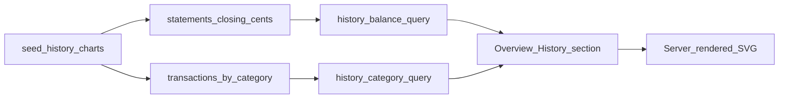

# Pitch: History charts (balances + categories)

**Status:** Shaped  
**Builder:** Cloud agent (Cloud-Build Mode)  
**Bettor:** Human PM  
**Appetite:** Small Batch (2 weeks)

---

## Problem

Overview is a **snapshot**: one closing balance per account (latest statement only). The PM cannot see how liquid balances moved across statement periods, or how pipeline `transaction_category` income vs spend evolved month over month. Multi-month history was deferred from dashboard refresh and still sits as a raw one-liner.

## Appetite

**Small Batch (2 weeks).** Good enough: extend **Overview** with a History section that shows (1) closing balances over statement periods and (2) category spend/income over calendar months — integer cents, local SVG (or vendored static JS only), synthetic multi-month seed, loud empty states. No new sidebar nav item in this appetite.

## Solution (breadboard)

1. Repository helpers: closing `*_cents` by `statement_end_date` (per account + liquid total); monthly `SUM(amount_cents)` by `transaction_category` / income-vs-spend buckets.
2. HTMX Overview fragment: History block under existing KPIs / accounts list; themes stay on `sapphire.css`.
3. Rendering: server-rendered SVG preferred; if JS is required, vendor under `app/static/` only (no CDN, no invented SRI).
4. Seed: `scripts/seed_history_charts.py` — multi-month synthetic statements + txns (`*0000`, `SYNTHETIC …`).

## Visuals (shaping)

- Wireframe: [`visuals/history_charts_wireframe.html`](visuals/history_charts_wireframe.html) (baseline snapshot Overview vs proposed History section).

## Rabbit holes

- True brokerage portfolio “net worth” vs cash-primary `closing_balance_cents`.
- Aligning statement periods to calendar months with a reconciliation UI.
- Chart.js / CDN / float axis math on money.
- ML or merchant categorization; YNAB envelope ↔ transaction linking.
- New nav “Charts” page or scrubbers / export.

## No-gos

- External CDNs or hallucinated SRI hashes.
- Float money; logging amounts or PII.
- YNAB envelope linking (separate backlog).
- New bank adapters; Grafana.
- High-fi design mid-build.

## Done-when

- [ ] Executable QA: `uv run python scripts/qa_history_charts.py` prints `[PASS]` / `[FAIL]` for happy and negative cases
- [ ] Manual UI QA: seed → Overview History shows both series; empty vault shows loud empty (not blank)
- [ ] Wireframe linked under `docs/specs/visuals/`
- [ ] Core invariants: integer cents, fail-loud contracts, no PII/amount logging
- [ ] CI gates: ruff + `pytest --cov=app --cov-fail-under=90`
- [ ] GitHub Project board updated (Lane=Shipped / Circuit-broken / Raw)

## Circuit breaker

Ship Overview History with both series + seed + empty states. Return portfolio net-worth scrubber, dedicated Charts nav, and Chart.js polish to [`raw_backlog.md`](raw_backlog.md).
