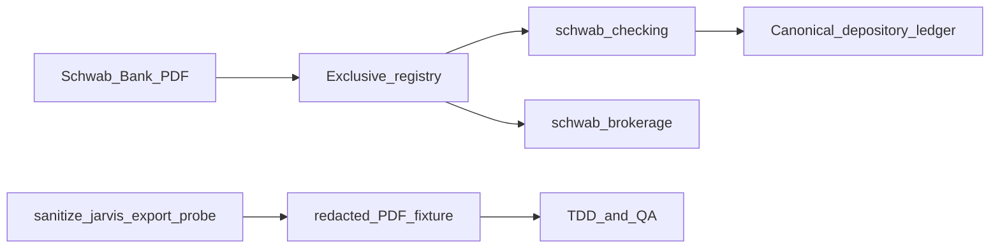

# Pitch: Schwab checking (Investor Checking) adapter

**Status:** In-bet  
**Builder:** Cloud agent (Cloud-Build Mode)  
**Bettor:** Human PM  
**Appetite:** Small Batch (2 weeks)

---

## Problem

Household checking lives at **Charles Schwab Bank** (Investor Checking) and SFFCU — not Chase. Uploading a Schwab bank statement today matches `schwab_brokerage` (page‑1 “Charles Schwab” only) and then fails loud on brokerage section markers. Brokerage already ships; checking does not.

## Appetite

**Small Batch (2 weeks).** Good enough: a registered `schwab_checking` depository adapter that matches Schwab **Bank** page‑1 chrome exclusively, parses a layout-faithful **redacted** PDF (real amounts, tokenized PII), reconciles integer cents, and uploads via the dashboard. Narrow `schwab_brokerage` so bank PDFs never steal the brokerage path. SFFCU stays out of scope.

## Solution (breadboard)

1. Offline fixture factory: sanitize → opaque JARVIS → `export_redacted_pdf.py` → `layout_probe.py`.
2. `SchwabCheckingAdapter` (depository) + mutual exclusion vs brokerage / Chase / Standard Bank.
3. Honest upload copy lists Schwab **checking** alongside Chase **card** and Schwab **brokerage**.

## Visuals (shaping)

- Copy note: [`visuals/schwab_checking_copy_note.md`](visuals/schwab_checking_copy_note.md).

## Rabbit holes

- Full Schwab multi-product packets (brokerage + bank in one PDF).
- SFFCU layouts.
- Debits/Credits dual-column edge cases beyond Investor Checking.

## No-gos

- No silent coercion of unmatched banks.
- No reading raw/sanitized statement bodies into Cursor.
- No float money; no PII/amount logging.
- No SFFCU in this appetite.

## Done-when

- [x] Executable QA: `uv run python scripts/qa_schwab_checking.py`
- [x] Manual UI QA: upload `tests/fixtures/redacted/schwab_checking_sample.pdf`; expect Vault Ledger. Brokerage fixture still `schwab_brokerage`. Unknown bank still `ADAPTER_MATCH_FAILED`.
- [x] Wireframe/copy note linked
- [ ] Core invariants + CI gates on PR
- [ ] GitHub Project board updated on merge

## Circuit breaker

Ship matcher + Investor Checking parse for the redacted contract; return dual-account Schwab packets and SFFCU to raw backlog.
